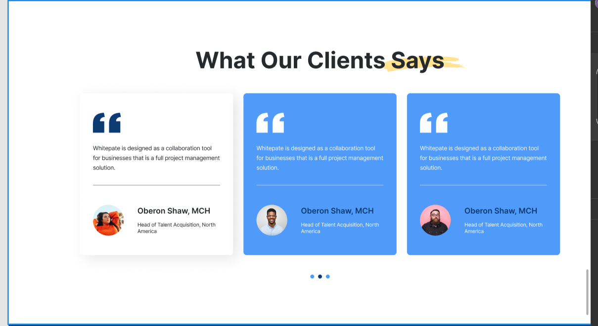
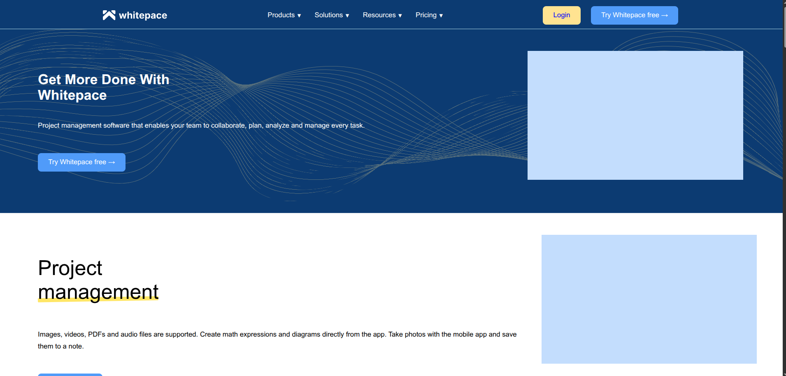
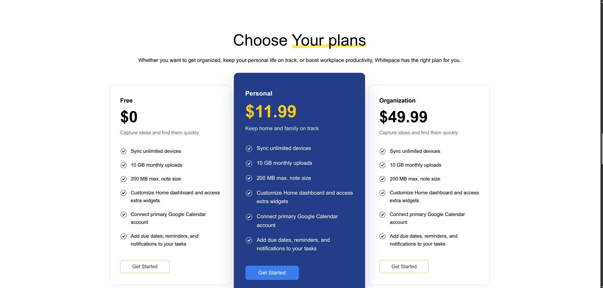
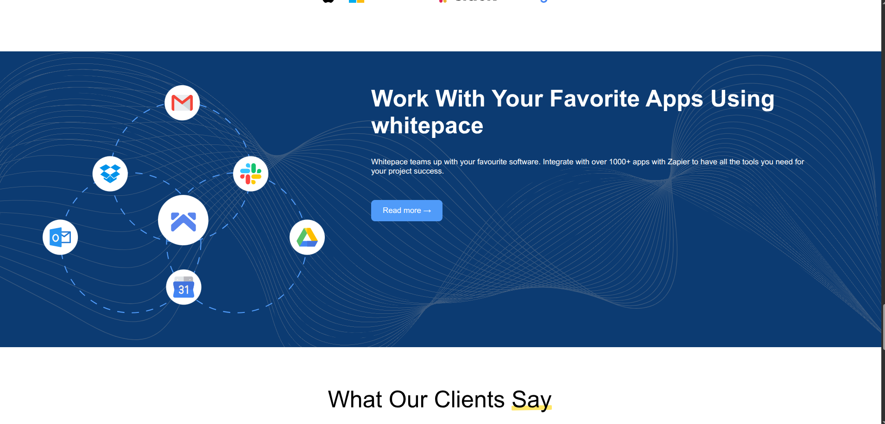
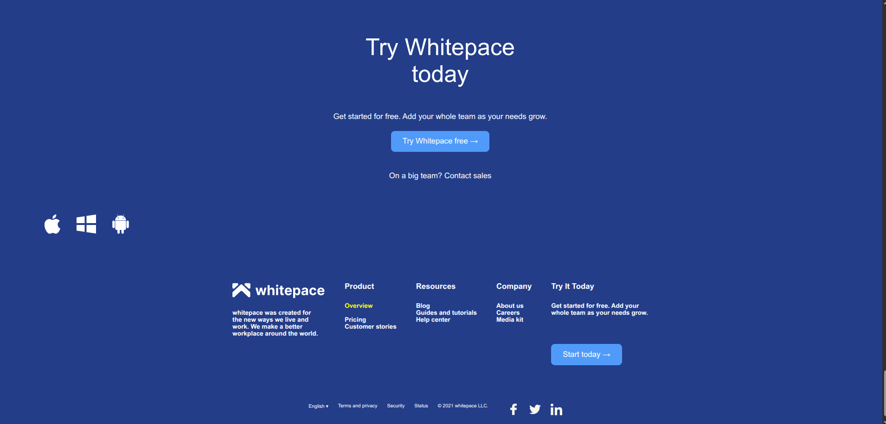

# 🎨 Whitepace — Figma Design Implementation

A responsive landing page built with HTML5 and CSS3, inspired by the Whitepace design in Figma. This project focuses on translating a visual design into a structured, accessible, and responsive web interface.

---

## 📌 Project Overview

The goal of this project is to recreate a landing page from a Figma design using HTML and CSS. It provides practical experience in translating design layouts into code, organizing page sections, and adapting the interface to different screen sizes.

The implementation includes navigation, a hero section, pricing plans, feature sections, testimonials, and a footer.

---

## 🎯 Project Goals

- Translate a Figma design into a functional web page.
- Practice semantic HTML5 and clean CSS3.
- Build reusable and well-organized page sections.
- Improve layout skills using Flexbox and responsive CSS.
- Create a consistent visual style across the page.
- Ensure the layout adapts to desktop, tablet, and mobile screens.
- Practice version control and automated code quality checks with GitHub.

---

## 🛠 Tech Stack

**Frontend**
- HTML5
- CSS3

**Tools**
- Git and GitHub
- Visual Studio Code
- Figma — design reference
- GitHub Actions — automated linting

---

## ✨ Features

- Responsive navigation bar.
- Hero section with call-to-action content.
- Feature and product information sections.
- Pricing plans section.
- Visual content and illustration layouts.
- Testimonial cards arranged in a blue, white, and blue color pattern.
- Horizontally scrollable testimonials on mobile devices.
- Responsive footer and page layout.
- Consistent typography, spacing, and colors.
- CSS-based styling without a frontend framework.

---

## 📱 Responsive Design

The page is designed to adapt to different viewport sizes, including:

- Mobile phones
- Tablets
- Desktop screens

On smaller screens, the layout adjusts to preserve readability and usability. The testimonial cards remain horizontally scrollable so users can access all three cards by swiping.

---

## 📸 Screenshot

Add a screenshot of the finished landing page here once it is available in the repository.







---

## ⚙️ Installation and Setup

### 1. Clone the repository

```bash
git clone git@github.com:Hache-premier/Figma-design.git
cd Figma-design
```

If you use HTTPS instead of SSH, clone the repository using its HTTPS URL.

### 2. Open the project

Open the project folder in Visual Studio Code.

```bash
code .
```

### 3. Run the page

Open `index.html` directly in your browser, or use the **Live Server** extension in VS Code:

1. Install Live Server if it is not already installed.
2. Open `index.html`.
3. Right-click inside the editor.
4. Select **Open with Live Server**.

No Node.js installation or frontend framework is required to run the page.

---

## 🧪 Code Quality

This repository uses GitHub Actions with Super-Linter to check supported files automatically.

The checks help identify issues in files such as HTML, CSS, Markdown, and workflow configuration files.

To keep the project maintainable:

- Use consistent indentation and formatting.
- Give sections and classes meaningful names.
- Keep the README headings correctly structured.
- Review GitHub Actions results after pushing changes.

---

## 🧠 Challenges and Learning Outcomes

This project provides practical experience with:

- Translating a visual design into HTML and CSS.
- Organizing complex pages into distinct sections.
- Using Flexbox to control layout and alignment.
- Managing spacing, typography, and color consistency.
- Creating responsive layouts with media queries.
- Making testimonial cards accessible on small screens.
- Debugging layout issues across viewport sizes.
- Using GitHub Actions to validate code quality.

---

## 🚀 Future Improvements

- Refine the layout to match the Figma reference more closely.
- Improve accessibility and keyboard navigation.
- Add subtle hover and focus effects.
- Optimize images and other visual assets.
- Review responsiveness across more devices and screen sizes.
- Improve automated checks and documentation.

---

## 👨🏽‍💻 Author

**Ndonwi Ashley Cheo**

Software Engineering

🌍 Cameroon | Passionate about web development and continuously learning new technologies.

---

## 📄 License

This project was created for learning and practice. Any original third-party design assets remain subject to their respective owners' rights.
